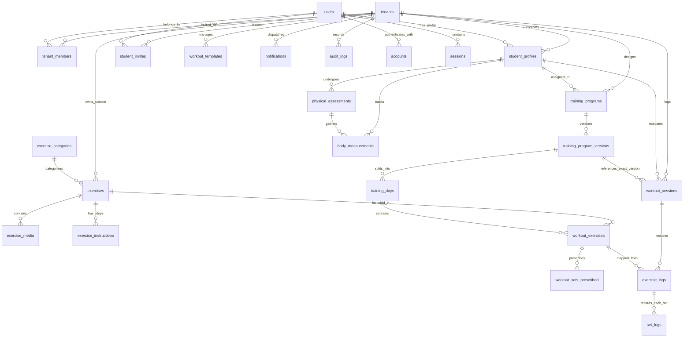

# Modelagem de Banco de Dados — FitFlow

## 1. Visão Geral e Princípios de Modelagem

O modelo de dados do **FitFlow** foi projetado para PostgreSQL (Neon Serverless) operando sob o ORM Prisma, fundamentado nas seguintes regras de engenharia:

1. **Chaves Primárias UUID v4:** Todas as entidades utilizam identificadores UUID (`gen_random_uuid()` no PostgreSQL ou `cuid()` / `uuid()` no Prisma) para prevenir ataques de enumeração sequencial de IDs.
2. **Isolamento de Tenant por Coluna (`tenant_id`):** Todas as entidades pertencentes ao escopo do personal trainer carregam a chave estrangeira `tenant_id` com restrição de chave e índices dedicados.
3. **Imutabilidade Histórica:** Treinos executados e séries realizadas (`workout_sessions`, `set_logs`) não sofrem mutação retroativa quando o treinador edita um treino futuro.
4. **Desacoplamento de Versão:** Programas de treino são versionados formalmente (`training_programs` -> `training_program_versions`).
5. **Preservação de Registros vs Integridade Referencial:** Exclusões lógicas (*soft delete*) são aplicadas em perfis de alunos e programas para manter intacto o histórico de atividades passadas. Exclusões em cascata físicas só ocorrem em rascunhos não publicados ou tabelas de junção efêmeras.
6. **Timestamps Padronizados:** Toda tabela possui `created_at` e `updated_at` com timezone (`TIMESTAMP WITH TIME ZONE`).

---

## 2. Diagrama Entidade-Relacionamento (ERD)



---

## 3. Especificação Detalhada das Entidades

### 3.1. Núcleo de Identidade, Autenticação e Multi-Tenancy

#### `tenants`
Representa o ambiente isolado de cada Personal Trainer.
- `id`: `UUID` (PK)
- `name`: `VARCHAR(255)` — Nome fantasia ou nome profissional do personal.
- `slug`: `VARCHAR(100)` (UNIQUE) — Identificador amigável em URLs.
- `status`: `ENUM('ACTIVE', 'SUSPENDED', 'CANCELLED')` — Estado operacional.
- `created_at`: `TIMESTAMPTZ`
- `updated_at`: `TIMESTAMPTZ`

#### `users`
Tabela global de identidades (um usuário é uma pessoa no sistema).
- `id`: `UUID` (PK)
- `name`: `VARCHAR(255)`
- `email`: `VARCHAR(255)` (UNIQUE, Index)
- `email_verified`: `TIMESTAMPTZ` (NULLable)
- `password_hash`: `VARCHAR(255)` (NULLable se OAuth for ativado)
- `image`: `VARCHAR(500)` (URL da foto)
- `created_at`: `TIMESTAMPTZ`
- `updated_at`: `TIMESTAMPTZ`

#### `tenant_members`
Vínculo e papel do usuário dentro de um tenant específico.
- `id`: `UUID` (PK)
- `tenant_id`: `UUID` (FK -> `tenants.id`, ON DELETE RESTRICT)
- `user_id`: `UUID` (FK -> `users.id`, ON DELETE CASCADE)
- `role`: `ENUM('OWNER', 'COACH', 'STUDENT')`
- `created_at`: `TIMESTAMPTZ`
- *Constraints:* UNIQUE(`tenant_id`, `user_id`)

#### `student_profiles`
Metadados específicos do perfil de aluno associado a um tenant.
- `id`: `UUID` (PK)
- `tenant_id`: `UUID` (FK -> `tenants.id`, ON DELETE RESTRICT)
- `user_id`: `UUID` (FK -> `users.id`, ON DELETE RESTRICT)
- `phone`: `VARCHAR(30)`
- `birth_date`: `DATE`
- `fitness_goal`: `ENUM('HYPERTROPHY', 'WEIGHT_LOSS', 'STRENGTH', 'HEALTH', 'REHABILITATION')`
- `experience_level`: `ENUM('BEGINNER', 'INTERMEDIATE', 'ADVANCED')`
- `status`: `ENUM('ACTIVE', 'PAUSED', 'ARCHIVED')`
- `trainer_notes`: `TEXT` (Observações confidenciais do personal)
- `health_conditions`: `TEXT` (Opcional, minimizado e consentido)
- `deleted_at`: `TIMESTAMPTZ` (Soft delete)
- `created_at`: `TIMESTAMPTZ`
- `updated_at`: `TIMESTAMPTZ`
- *Índices:* `(tenant_id, status)`, `(tenant_id, user_id)`

#### `student_invites`
Tokens de ativação de novos alunos enviados pelo personal.
- `id`: `UUID` (PK)
- `tenant_id`: `UUID` (FK -> `tenants.id`, ON DELETE CASCADE)
- `invited_by_user_id`: `UUID` (FK -> `users.id`)
- `email`: `VARCHAR(255)`
- `token_hash`: `VARCHAR(255)` (UNIQUE, Index)
- `status`: `ENUM('PENDING', 'ACCEPTED', 'EXPIRED', 'REVOKED')`
- `expires_at`: `TIMESTAMPTZ`
- `accepted_at`: `TIMESTAMPTZ`
- `created_at`: `TIMESTAMPTZ`
- *Índices:* `(tenant_id, email)`, `token_hash`

#### `accounts`, `sessions`, `verification_tokens`, `password_reset_tokens`
Tabelas padrão de autenticação do Auth.js com Prisma Adapter:
- Suporte a cookies seguros e tokens de recuperação de senha com validade de 60 minutos.

---

### 3.2. Biblioteca de Exercícios

#### `exercise_categories`
Categorias anatômicas e funcionais padronizadas.
- `id`: `UUID` (PK)
- `name`: `VARCHAR(100)` (Ex: "Peito", "Costas", "Quadríceps", "Mobilidade")
- `slug`: `VARCHAR(100)` (UNIQUE)
- `description`: `TEXT`
- `icon_name`: `VARCHAR(50)`
- `order_index`: `INT` DEFAULT 0

#### `exercises`
Catálogo de exercícios (híbrido: globais do sistema ou customizados do tenant).
- `id`: `UUID` (PK)
- `tenant_id`: `UUID` (NULLable -> NULL indica exercício Global; se preenchido, é Custom do Tenant)
- `category_id`: `UUID` (FK -> `exercise_categories.id`)
- `name`: `VARCHAR(255)` (Index)
- `description`: `TEXT`
- `primary_muscle_group`: `VARCHAR(100)`
- `secondary_muscle_groups`: `TEXT[]` (Array de strings com músculos sinergistas)
- `equipment`: `ENUM('BARBELL', 'DUMBBELL', 'MACHINE', 'CABLE', 'BODYWEIGHT', 'KETTLEBELL', 'BAND', 'OTHER')`
- `difficulty`: `ENUM('BEGINNER', 'INTERMEDIATE', 'ADVANCED')`
- `is_global`: `BOOLEAN` DEFAULT false
- `created_at`: `TIMESTAMPTZ`
- `updated_at`: `TIMESTAMPTZ`
- *Índices:* `(tenant_id, is_global)`, `(category_id, name)`

#### `exercise_media`
Mídias demonstrativas (vídeos e imagens).
- `id`: `UUID` (PK)
- `exercise_id`: `UUID` (FK -> `exercises.id`, ON DELETE CASCADE)
- `media_type`: `ENUM('VIDEO', 'IMAGE', 'GIF')`
- `url`: `VARCHAR(500)`
- `storage_provider`: `ENUM('R2', 'YOUTUBE', 'VIMEO', 'EXTERNAL')`
- `thumbnail_url`: `VARCHAR(500)`
- `order_index`: `INT` DEFAULT 0

#### `exercise_instructions`
Passo a passo técnico de execução e dicas de segurança.
- `id`: `UUID` (PK)
- `exercise_id`: `UUID` (FK -> `exercises.id`, ON DELETE CASCADE)
- `step_number`: `INT`
- `instruction`: `TEXT`
- `safety_tip`: `TEXT`

---

### 3.3. Prescrição de Treinamento e Versionamento

#### `training_programs`
O programa geral atribuído a um aluno.
- `id`: `UUID` (PK)
- `tenant_id`: `UUID` (FK -> `tenants.id`, ON DELETE RESTRICT)
- `student_profile_id`: `UUID` (FK -> `student_profiles.id`, ON DELETE RESTRICT)
- `title`: `VARCHAR(255)` (Ex: "Periodização Foco em Força")
- `description`: `TEXT`
- `goal`: `VARCHAR(100)`
- `start_date`: `DATE`
- `end_date`: `DATE` (NULLable)
- `is_active`: `BOOLEAN` DEFAULT true
- `created_at`: `TIMESTAMPTZ`
- `updated_at`: `TIMESTAMPTZ`
- *Índices:* `(tenant_id, student_profile_id, is_active)`

#### `training_program_versions`
Versões imutáveis da prescrição para garantir histórico íntegro.
- `id`: `UUID` (PK)
- `program_id`: `UUID` (FK -> `training_programs.id`, ON DELETE RESTRICT)
- `version_number`: `INT` DEFAULT 1
- `status`: `ENUM('DRAFT', 'PUBLISHED', 'ARCHIVED')`
- `notes`: `TEXT`
- `published_at`: `TIMESTAMPTZ` (NULLable enquanto for DRAFT)
- `created_at`: `TIMESTAMPTZ`
- *Índices:* `(program_id, status)`

#### `training_days`
Os dias de treino de uma versão (Ex: Treino A, Treino B, Treino C).
- `id`: `UUID` (PK)
- `version_id`: `UUID` (FK -> `training_program_versions.id`, ON DELETE CASCADE)
- `name`: `VARCHAR(100)` (Ex: "Treino A - Peito e Tríceps")
- `day_of_week`: `ENUM('MONDAY', 'TUESDAY', 'WEDNESDAY', 'THURSDAY', 'FRIDAY', 'SATURDAY', 'SUNDAY', 'ANY')`
- `description`: `TEXT`
- `order_index`: `INT` DEFAULT 0
- *Índices:* `(version_id, order_index)`

#### `workout_exercises`
Exercícios alocados em um dia específico, com suporte a agrupamento em Super-séries.
- `id`: `UUID` (PK)
- `training_day_id`: `UUID` (FK -> `training_days.id`, ON DELETE CASCADE)
- `exercise_id`: `UUID` (FK -> `exercises.id`, ON DELETE RESTRICT)
- `superset_group_id`: `VARCHAR(50)` (NULLable; exercícios com mesmo ID formam Bi-set/Tri-set)
- `section_type`: `ENUM('WARMUP', 'MAIN', 'COOLDOWN')` DEFAULT 'MAIN'
- `order_index`: `INT` DEFAULT 0
- `coach_notes`: `TEXT` (Instruções pontuais do personal)
- *Índices:* `(training_day_id, order_index)`

#### `workout_sets_prescribed`
Especificação das séries prescritas pelo treinador para o exercício.
- `id`: `UUID` (PK)
- `workout_exercise_id`: `UUID` (FK -> `workout_exercises.id`, ON DELETE CASCADE)
- `set_number`: `INT`
- `reps_target`: `VARCHAR(50)` (Ex: "10-12" ou "8" ou "Até a falha")
- `suggested_load_kg`: `DECIMAL(6,2)` (NULLable)
- `rest_seconds`: `INT` DEFAULT 60
- `tempo`: `VARCHAR(20)` (Ex: "3-0-1-0" opcional)
- `target_rpe`: `DECIMAL(3,1)` (Ex: 8.5 opcional)

#### `workout_templates`
Modelos de treinos ou semanas reutilizáveis salvos na biblioteca do personal.
- `id`: `UUID` (PK)
- `tenant_id`: `UUID` (FK -> `tenants.id`, ON DELETE CASCADE)
- `title`: `VARCHAR(255)`
- `category`: `VARCHAR(100)`
- `template_data`: `JSONB` (Snapshot serializado da estrutura de dias, exercícios e séries)
- `created_at`: `TIMESTAMPTZ`

---

### 3.4. Execução e Acompanhamento de Treinos

#### `workout_sessions`
Registro real de cada sessão realizada pelo aluno.
- `id`: `UUID` (PK)
- `tenant_id`: `UUID` (FK -> `tenants.id`, ON DELETE RESTRICT)
- `student_profile_id`: `UUID` (FK -> `student_profiles.id`, ON DELETE RESTRICT)
- `program_version_id`: `UUID` (FK -> `training_program_versions.id`, ON DELETE RESTRICT)
- `training_day_id`: `UUID` (FK -> `training_days.id`, ON DELETE RESTRICT)
- `started_at`: `TIMESTAMPTZ` (Início do treino)
- `completed_at`: `TIMESTAMPTZ` (Fim do treino)
- `status`: `ENUM('IN_PROGRESS', 'COMPLETED', 'ABANDONED')`
- `perceived_exertion_rpe`: `INT` (Escala 1 a 10 informada pelo aluno)
- `student_feedback`: `TEXT`
- `total_duration_seconds`: `INT`
- `total_volume_kg`: `DECIMAL(10,2)` (Volume acumulado calculado: Σ reps * carga)
- *Índices:* `(tenant_id, student_profile_id, completed_at)`, `(status, started_at)`

#### `exercise_logs`
Exercício executado dentro de uma sessão.
- `id`: `UUID` (PK)
- `workout_session_id`: `UUID` (FK -> `workout_sessions.id`, ON DELETE CASCADE)
- `exercise_id`: `UUID` (FK -> `exercises.id`, ON DELETE RESTRICT)
- `workout_exercise_id`: `UUID` (FK -> `workout_exercises.id`, ON DELETE SET NULL)
- `order_index`: `INT`
- `is_completed`: `BOOLEAN` DEFAULT false
- `notes`: `TEXT`

#### `set_logs`
Cada série individual registrada pelo aluno.
- `id`: `UUID` (PK)
- `exercise_log_id`: `UUID` (FK -> `exercise_logs.id`, ON DELETE CASCADE)
- `set_number`: `INT`
- `prescribed_load_kg`: `DECIMAL(6,2)` (Valor de referência da prescrição)
- `actual_load_kg`: `DECIMAL(6,2)` (Carga real levantada)
- `prescribed_reps`: `VARCHAR(50)` (Meta prescrita)
- `actual_reps`: `INT` (Repetições completadas com sucesso)
- `completed`: `BOOLEAN` DEFAULT true
- `rest_taken_seconds`: `INT`
- `rpe`: `DECIMAL(3,1)` (Opcional)
- `logged_at`: `TIMESTAMPTZ` DEFAULT now()
- *Índices:* `(exercise_log_id, set_number)`

---

### 3.5. Avaliações e Medidas Físicas

#### `physical_assessments`
Avaliação física periódica.
- `id`: `UUID` (PK)
- `tenant_id`: `UUID` (FK -> `tenants.id`, ON DELETE CASCADE)
- `student_profile_id`: `UUID` (FK -> `student_profiles.id`, ON DELETE CASCADE)
- `assessment_date`: `DATE`
- `evaluator_user_id`: `UUID` (FK -> `users.id`)
- `weight_kg`: `DECIMAL(5,2)`
- `height_cm`: `DECIMAL(5,2)`
- `body_fat_percentage`: `DECIMAL(4,2)` (NULLable)
- `muscle_mass_percentage`: `DECIMAL(4,2)` (NULLable)
- `notes`: `TEXT`
- `created_at`: `TIMESTAMPTZ`
- *Índices:* `(tenant_id, student_profile_id, assessment_date)`

#### `body_measurements`
Circunferências corporais em centímetros.
- `id`: `UUID` (PK)
- `assessment_id`: `UUID` (FK -> `physical_assessments.id`, ON DELETE CASCADE)
- `chest_cm`: `DECIMAL(5,2)`
- `waist_cm`: `DECIMAL(5,2)`
- `abdomen_cm`: `DECIMAL(5,2)`
- `hips_cm`: `DECIMAL(5,2)`
- `right_arm_cm`: `DECIMAL(5,2)`
- `left_arm_cm`: `DECIMAL(5,2)`
- `right_thigh_cm`: `DECIMAL(5,2)`
- `left_thigh_cm`: `DECIMAL(5,2)`
- `right_calf_cm`: `DECIMAL(5,2)`
- `left_calf_cm`: `DECIMAL(5,2)`

---

### 3.6. Notificações e Auditoria

#### `notifications`
Mensagens e alertas in-app para treinador e aluno.
- `id`: `UUID` (PK)
- `tenant_id`: `UUID` (FK -> `tenants.id`, ON DELETE CASCADE)
- `user_id`: `UUID` (FK -> `users.id`, ON DELETE CASCADE)
- `title`: `VARCHAR(255)`
- `message`: `TEXT`
- `type`: `ENUM('WORKOUT_ASSIGNED', 'WORKOUT_COMPLETED', 'PR_ACHIEVED', 'INVITE', 'SYSTEM')`
- `link`: `VARCHAR(500)` (Deep link na plataforma)
- `read`: `BOOLEAN` DEFAULT false
- `created_at`: `TIMESTAMPTZ`
- *Índices:* `(user_id, read, created_at)`

#### `audit_logs`
Rastreamento de segurança e compliance LGPD.
- `id`: `UUID` (PK)
- `tenant_id`: `UUID` (NULLable para eventos globais)
- `user_id`: `UUID` (NULLable para ações não autenticadas)
- `action`: `VARCHAR(100)` (Ex: `LOGIN`, `PASSWORD_RESET`, `INVITE_SENT`, `PROGRAM_PUBLISHED`, `DATA_EXPORT_REQUESTED`)
- `resource`: `VARCHAR(100)`
- `resource_id`: `VARCHAR(100)`
- `ip_address`: `VARCHAR(45)`
- `user_agent`: `TEXT`
- `metadata`: `JSONB`
- `created_at`: `TIMESTAMPTZ` DEFAULT now()
- *Índices:* `(tenant_id, action, created_at)`

---

## 4. Otimização de Queries e Estratégia de Indexação

Em conformidade com a skill `sql-optimization`:
1. **Index Scans por Tenant:** Nenhuma consulta de alunos, programas ou sessões fará Seq Scan em produção, graças aos índices compostos de prefixo `tenant_id`.
2. **Cálculo Eficiente de Cargas Anteriores:** Para buscar a carga executada no último treino de um dado exercício pelo aluno, utiliza-se a seguinte consulta indexada:
   ```sql
   SELECT sl.actual_load_kg, sl.actual_reps
   FROM set_logs sl
   JOIN exercise_logs el ON sl.exercise_log_id = el.id
   JOIN workout_sessions ws ON el.workout_session_id = ws.id
   WHERE ws.student_profile_id = $studentId
     AND ws.tenant_id = $tenantId
     AND el.exercise_id = $exerciseId
     AND ws.status = 'COMPLETED'
   ORDER BY ws.completed_at DESC, sl.set_number ASC
   LIMIT 10;
   ```
   Índices compostos em `workout_sessions(tenant_id, student_profile_id, completed_at)` garantem execução em menos de 5ms.
