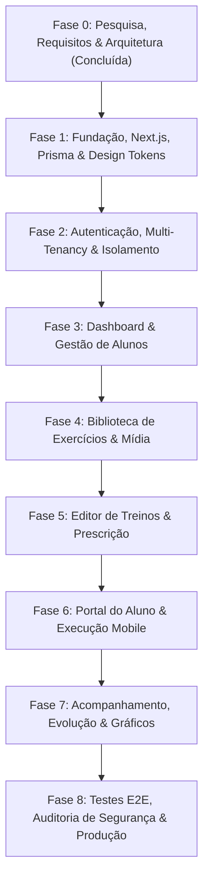

# Roadmap de Implementação e Plano de Entrega — FitFlow

## 1. Visão Geral do Roadmap

O desenvolvimento do **FitFlow** seguirá uma estratégia estritamente faseada, garantindo que cada etapa entregue valor funcional real, conectado ao banco de dados e protegido contra falhas de segurança e multi-tenancy.

Em consonância com as regras de engenharia, **nenhuma fase será dada como concluída sem execução e comprovação de testes automatizados e validação de qualidade de código**.

---

## 2. Detalhamento das Fases

### FASE 0 — Research e Planejamento (CONCLUÍDA)
- [x] Inspeção do ambiente e inventário de ferramentas instaladas.
- [x] Instalação e verificação de skills especializadas no projeto.
- [x] Análise competitiva e engenharia reversa de Trainerize, TrueCoach e Everfit.
- [x] Elaboração da Matriz Competitiva (`docs/research/competitive-analysis.md`).
- [x] Documento de Requisitos de Produto — PRD (`docs/product/product-requirements.md`).
- [x] Arquitetura de Alto Nível e Topologia (`docs/architecture/architecture-overview.md`).
- [x] Modelagem Conceitual e Lógica do Banco de Dados com ERD (`docs/architecture/database-design.md`).
- [x] Plano de Segurança Multi-Tenant e Conformidade LGPD (`docs/security/security-model.md`).
- [x] Especificação do Design System e Tokens Visuais (`docs/architecture/design-system.md`).
- [x] Inventário de Skills do Projeto (`docs/engineering/skills-inventory.md`).
- [x] Roadmap de Implementação com Critérios de Aceite (`docs/engineering/implementation-roadmap.md`).

---

### FASE 1 — Fundação e Setup Técnico
**Objetivo:** Criar o esqueleto executável do projeto Next.js com TypeScript strict, Tailwind, shadcn/ui, Prisma ORM e layout base.

- **Tarefas:**
  1. Inicializar o projeto Next.js com App Router e TypeScript estrito.
  2. Configurar ESLint e Prettier com regras de importação limpa e boas práticas da Vercel.
  3. Configurar Tailwind CSS e os design tokens definidos no Design System (grafite escuro, superfícies em carvão, esmeralda esportivo).
  4. Configurar shadcn/ui com componentes base (Button, Input, Card, Dialog, Dropdown, Table, Badge, Tabs, Toast).
  5. Configurar Prisma ORM com schema completo e script de migração inicial para Neon PostgreSQL.
  6. Configurar suite de testes unitários com Vitest e React Testing Library.
  7. Implementar casca dos layouts principais: layout público, layout do treinador `(coach)` e layout do aluno `(student)`.
- **Definition of Done (DoD):**
  - Aplicação compila sem erros (`npm run build`).
  - Prisma client gerado com tipagem TypeScript 100% estrita.
  - Teste de sanidade do Vitest executado e aprovado.
  - Layouts responsivos renderizando corretamente nos navegadores.

---

### FASE 2 — Autenticação e Isolamento Multi-Tenancy
**Objetivo:** Implementar o núcleo de identidade, permissões e isolamento estrito entre treinadores e alunos.

- **Tarefas:**
  1. Configurar Auth.js com Prisma Adapter e credenciais seguras (bcrypt).
  2. Implementar fluxo de cadastro do Personal Trainer (criação atômica de `user` + `tenant` + `tenant_member` com role `OWNER`).
  3. Implementar telas de Login, Logout e Recuperação de Senha com tokens expiráveis.
  4. Implementar sistema de Convite de Aluno com hash SHA-256 e tela de ativação de conta do aluno.
  5. Implementar Middleware de segurança protegendo rotas `/coach/*` e `/student/*`.
  6. Desenvolver a camada de autorização `getAuthorizedTenantContext()` e travas anti-IDOR.
  7. Criar testes automatizados de isolamento (Personal A tentando acessar dados de B é rejeitado com 404/403).
- **Definition of Done (DoD):**
  - Dois personal trainers conseguem se cadastrar e logar independentemente.
  - Aluno convidado consegue ativar sua conta e logar no portal do aluno.
  - Testes de segurança contra IDOR executados e 100% aprovados.

---

### FASE 3 — Dashboard e Gestão de Alunos
**Objetivo:** Desenvolver o ambiente operacional de gestão do treinador com dados reais do banco.

- **Tarefas:**
  1. Construir o Dashboard do Treinador com KPIs calculados diretamente no banco de dados via consultas SQL otimizadas.
  2. Implementar CRUD completo de Alunos (criação via convite, edição de dados cadastrais, alteração de status ativo/pausado).
  3. Desenvolver a Ficha Unificada do Aluno com histórico de treinos e anamnese simplificada em conformidade com a LGPD.
  4. Implementar busca instantânea por nome, filtros de status e paginação cursor-based.
- **Definition of Done (DoD):**
  - Treinador visualiza métricas dinâmicas reais do seu tenant.
  - Gestão de alunos 100% funcional com validação Zod e persistência segura no Neon.

---

### FASE 4 — Biblioteca de Exercícios e Mídia
**Objetivo:** Criar o catálogo pesquisável de exercícios com suporte a vídeos e mídias demonstrativas.

- **Tarefas:**
  1. Criar seed com exercícios globais padrão organizados por todas as 12 categorias anatômicas com imagens e vídeos demonstrativos.
  2. Implementar interface de navegação e busca instantânea com filtros por músculo e equipamento.
  3. Implementar criação de exercícios customizados pelo personal trainer (visíveis somente no tenant dele).
  4. Configurar upload seguro para Cloudflare R2 ou incorporação de vídeos (YouTube/Vimeo).
  5. Modal detalhado de instruções técnicas, erros comuns e dicas de postura.
- **Definition of Done (DoD):**
  - Catálogo global acessível e imutável para os tenants.
  - Personal trainer cadastra e gerencia seus próprios exercícios customizados.
  - Filtros rápidos funcionando com zero lag.

---

### FASE 5 — Editor de Treinos e Programação Semanal
**Objetivo:** Implementar o editor de prescrição com separação de versão e calendário.

- **Tarefas:**
  1. Construir o Workout Builder em 2 colunas com gaveta de busca de exercícios e canvas contínuo.
  2. Implementar gestão de Dias de Treino (Treino A, B, C...) com reordenação e agrupamento em Super-séries.
  3. Desenvolver tabela inline de séries (Reps, Carga Sugerida, Descanso, Cadência, RPE).
  4. Implementar lógica de versionamento (`DRAFT` -> `PUBLISHED`), garantindo imutabilidade de versões anteriores.
  5. Implementar Calendário de Programação Semanal (atribuição de dias aos alunos com flexibilidade de divisões).
  6. Salvar e reutilizar modelos de treino (`workout_templates`).
- **Definition of Done (DoD):**
  - Treinador monta uma periodização completa e publica para o aluno.
  - Edições posteriores geram nova versão sem alterar históricos passados.

---

### FASE 6 — Portal do Aluno e Execução Mobile
**Objetivo:** Entregar a experiência mobile-first para o aluno executar seu treino na academia.

- **Tarefas:**
  1. Construir Home do Aluno com destaque no "Treino de Hoje" e agenda da semana.
  2. Desenvolver a tela de execução de treino com foco visual em cada exercício, demonstração em vídeo e histórico da última carga realizada.
  3. Implementar marcação de série com acionamento automático do cronômetro de descanso (com avisos visuais e sonoros/vibração).
  4. Implementar sincronização de estado em `localStorage` para resiliência contra fechamento acidental da aba.
  5. Implementar encerramento de treino com cálculo de tonelagem total (volume) e gravação atômica em `workout_sessions` e `set_logs`.
  6. Configurar PWA com `manifest.json`, ícones e modo standalone.
- **Definition of Done (DoD):**
  - Aluno inicia um treino no smartphone, marca séries, usa cronômetro e finaliza a sessão com persistência no banco.
  - Recarregamento da página não perde os dados da sessão em andamento.

---

### FASE 7 — Acompanhamento e Evolução
**Objetivo:** Fornecer inteligência de dados e gráficos claros de progresso físico e de desempenho.

- **Tarefas:**
  1. Implementar gráficos de frequência e adesão semanal utilizando Recharts.
  2. Implementar gráfico de evolução de carga por exercício individual (sobrecarga progressiva e 1RM estimada).
  3. Implementar cálculo e visualização de volume semanal acumulado (kg por grupo muscular).
  4. Implementar registro e histórico gráfico de medidas corporais e peso.
- **Definition of Done (DoD):**
  - Gráficos renderizam dados reais calculados sem distorções de escala.
  - Treinador e aluno conseguem visualizar a evolução de carga com clareza.

---

### FASE 8 — Testes E2E, Auditoria de Segurança e Produção
**Objetivo:** Blindar o sistema com automação completa de testes, auditoria OWASP/LGPD e preparação para deploy.

- **Tarefas:**
  1. Desenvolver testes E2E com Playwright cobrindo o fluxo crítico completo (Coach cria treino -> Aluno executa -> Coach confere no dashboard).
  2. Executar suíte de testes de estresse contra IDOR e injeção de dados.
  3. Realizar auditoria de qualidade de código conforme a skill `code-review-and-quality`.
  4. Otimizar bundle e imagens para atendimento estrito às metas de Core Web Vitals.
  5. Elaborar manual de operações e procedimento de backup.
- **Definition of Done (DoD):**
  - Cobertura de testes automatizados nos fluxos críticos.
  - Zero vulnerabilidades críticas no `npm audit`.
  - MVP pronto para comercialização e uso com usuários reais.

---

## 3. Matriz de Riscos Técnicos e Mitigações

| Risco Técnico Identificado | Impacto | Probabilidade | Estratégia de Mitigação |
|---|---|---|---|
| **Vazamento de dados entre inquilinos (Quebra Multi-Tenant)** | Crítico | Baixa | Imposição arquitetural via `tenant_id` obrigatório em todo serviço + testes automatizados de tentativa de invasão horizontal. |
| **Corrupção de histórico de treinos por edição de fichas** | Alto | Média | Separação formal entre Prescrição (`training_program_versions`) e Execução (`workout_sessions`). Versões publicadas são somente-leitura. |
| **Queda de conexão na academia durante a execução do treino** | Alto | Alta | Persistência local contínua do estado da sessão em `localStorage` com restauração transparente ao reconectar. |
| **Gargalo de conexão no banco serverless (Neon)** | Médio | Média | Utilização estrita de connection pooling (`-pooler`) para a aplicação e conexão direta reservada para migrations Prisma. |
| **Lentidão em consultas históricas de grandes volumes de treinos** | Médio | Média | Criação de índices B-Tree compostos iniciando por `tenant_id` em todas as tabelas transacionais de alta frequência. |

---

## 4. Próxima Etapa Imediata (Fase 1)

Assim que a autorização for concedida pelo usuário:
1. Inicializar o projeto Next.js com App Router e TypeScript estrito na raiz do workspace.
2. Instalar e configurar Prisma ORM com PostgreSQL (Neon).
3. Configurar Tailwind CSS, variáveis de design tokens e biblioteca shadcn/ui.
4. Estruturar os diretórios modulares conforme a especificação arquitetural.
